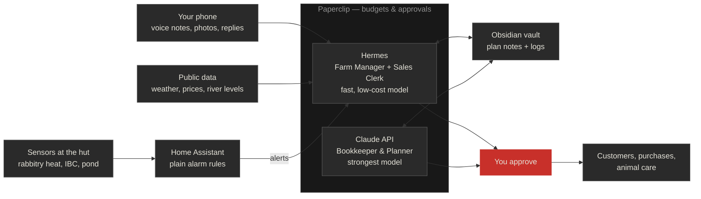

# 🤖 AI Farm Agents (draft v2)

> [!abstract] The idea
> AI agents do the **remembering, logging, checking and drafting**. You do the farming and make every decision that **spends money, messages a customer or touches an animal's health**.
> It runs on the Hermes + Paperclip setup you're testing. This is a personal (pension) project, so it can use **any LLM API**: a fast, low-cost model for everyday jobs, and the strongest model only where accuracy pays off — all under a **monthly spending cap**.

> [!note] What changed in v2
> The subscriptions-only rule is gone for this project. New: a model-per-job plan, the Claude Bookkeeper runs on the API, stronger photo checks, a monthly market & grants scan, speech-to-text for Malay/English voice notes, a backup provider, and API costs added to the budget.

---

## 🧭 How it fits together

---

## ✅ What the agents do — and what stays with you

| Job | Agent does | You do |
|:---|:---|:---|
| **Daily brief** | 06:30 message: today's jobs from the plan (bed schedule, animal dates, milestones), weather, any alert | Read it, farm |
| **Logging** | Turns voice notes and photos ("12 eggs, 3 kg kangkung sold RM12") into lines in [[Harvest Log]] and [[Sales & Trade Log]] | Send the voice note |
| **Reminders** | Sowing dates from [[05a Block C Cash Beds]], rabbit nest box (day 27) and weaning, vaccinations, deworming, drain clearing before November | Do the job |
| **Sales** | Wednesday harvest list, WhatsApp broadcast draft in BM and English, order tally, Friday delivery list | Approve and send |
| **Money** | Monthly surplus split (50/30/20), [[Expansion Fund Ledger]], "the Fund now covers the freezer" check against [[17 Expansion Fund & Upgrade Ladder]] | Decide every purchase |
| **Watch** | Heavy-rain warnings, river level, rabbitry temperature, IBC and pond levels → alerts | Act on the alert |
| **Photo checks** | Pests, plant disease and animal warning signs, using the strongest vision model: likely cause, how sure, what to check next | Confirm; animals go to DVS Rembau |
| **Market & grants scan** | Monthly: local prices for the stall, RISDA TSGL and incentive intakes, deadlines | Set prices, apply |

**Never without you:** spending, messaging customers, medicating animals, or switching pumps and valves.

---

## 🧠 Which model does which job

| Job | Model | Why |
|:---|:---|:---|
| Chat, logging, reminders, daily brief | **Fast, low-cost** (DeepSeek, Qwen, a GPT mini model or Claude Haiku) | Dozens of small jobs a day; keeps cost low |
| Harvest list & broadcast drafts | **Fast, low-cost** — pick the one whose Malay reads most natural | Short writing; test 2–3 models on real drafts |
| Photo checks | **Strongest vision model** (Claude or GPT) | Accuracy matters more than cost; only a few a week |
| Weekly review, money split, plan suggestions | **Strongest reasoning model** (Claude Opus or Sonnet) | Reads the whole plan plus the week's logs, once a week |
| Voice notes | **Speech-to-text API** | Mixed Malay/English — test on your own voice notes first |
| Backup | **Second provider** (e.g. via OpenRouter) | If one provider is down, the morning brief still arrives |

Hermes can switch providers and models without code changes, so try cheap first and move a job up a tier only if its output isn't good enough.

---

## 👥 The agent team — start with one, grow to three

Start with **Hermes on its own** (Stage 1). Move into Paperclip as a "Farm" company when the Sales Clerk and Bookkeeper are added (Stage 2) — that's where per-agent budgets, cost tracking by model and approvals pay off.

| Agent | Runs on | Wakes | Owns |
|:---|:---|:---|:---|
| **Farm Manager** (lead) | Hermes · fast, low-cost model | 06:30 daily, and on every message from you | Daily brief, logging, reminders, alerts, photo checks (handed to the strong model); passes work to the others |
| **Sales Clerk** | Hermes · fast, low-cost model | Wed 20:00, Thu & Fri mornings | Harvest list, broadcast draft, orders, delivery list, sales log |
| **Bookkeeper & Planner** | Claude API · strongest model, in Paperclip | Sunday evening, 1st of the month | Weekly review against the plan, monthly money split, ledger, market & grants scan, plan changes as *suggestions* |

Sensor alarms stay **plain rules in Home Assistant, not AI** — they fire reliably and cost nothing. The Farm Manager only explains the alert and suggests what to do.

---

## 🔌 What feeds it

| Input | How | Notes |
|:---|:---|:---|
| **Plan notes** | Syncthing keeps the RW farm folder in sync with the Hermes VM/VPS | Agents read 05a, 15, 18 and the animal notes as their job list |
| **You** | Telegram bot → Hermes, with speech-to-text for voice notes | Keep **WhatsApp for customers only**, so the agent never touches customer chats |
| **Weather & prices** | Free public data: MET Malaysia forecasts & warnings, KPDN PriceCatcher prices (data.gov.my) | Plus a web search API for the monthly market & grants scan |
| **River level** | JPS Public InfoBanjir — nearest station, if there is one | Avoids a sensor on land that isn't yours |
| **Sensors** (Stage 3) | ESP32 boards: rabbitry temperature, IBC and pond levels → MQTT → Home Assistant | Needs 4G and power at the hut — check in Phase 0 |

---

## 🪜 Stages (alongside the farm phases)

| Stage | When | What gets built | Cost (est.) |
|:---|:---|:---|---:|
| **1. Farm assistant** | Nov – Dec 2026 | Hermes on Telegram: daily brief, voice-note logging, reminders from 05a and the Phase 0 checklist, photo checks | APIs ≈RM5 – 20 / month |
| **2. Sales & money** | Jan – Mar 2027 | Sales Clerk (first sales Mar 2027); Claude Bookkeeper with Sunday review, monthly split and market & grants scan; both moved into Paperclip with budgets and approvals | APIs ≈RM20 – 60 / month in total |
| **3. Field watch** | Apr – May 2027, before the rabbits arrive | Home Assistant, rabbitry heat alarm (the farm's highest risk), IBC and pond levels, rain and river alerts | ≈RM400 – 900 one-off + 4G ≈RM30 – 50 / month |
| **4. More of the farm** | 2028 | Rabbit doe cards, kelulut hive checks, paddy water and solar pump **alerts** — any control only with a manual override | From the Fund |

> [!info] Add to running costs ([[14 Budget & Low-Cost Strategy]])
> AI APIs ≈**RM240 – 720 a year** (capped at RM80 a month) and, from Stage 3, 4G data ≈**RM360 – 600 a year**. These are planning estimates: replace them with the real bill after the first 2 months.

*Stage 3 hardware estimate:* 3 ESP32 boards, temperature and level sensors, a 4G router, and a small solar panel and battery if the hut has no power — get local quotes.

---

## 🛡️ Guardrails

- [ ] **Approval first:** sends, spends and animal treatments wait for your "yes" (Paperclip approvals, Hermes command approval)
- [ ] **Agents add, you change:** agents append to logs and write plan changes into a *Suggested edits* note; only you edit the plan notes
- [ ] **Alarms are rules, AI explains:** monitor first, control later — never let an agent switch a pump with no manual override
- [ ] **Animal health:** the agent flags and suggests what to check; diagnosis and medicine come from DVS Rembau
- [ ] **Spending caps:** a monthly limit set at each API provider, plus a per-agent budget in Paperclip; cheap model by default; check the bill monthly
- [ ] **Data you send out:** farm data only — no customer phone numbers, IC numbers or bank details go to any API; log customers by name only
- [ ] **Keys & access:** API keys in the VM's secret store, never in the vault; no ports open to the internet; VPS, VM and hut on a WireGuard VPN; a separate bot account
- [ ] **Sunday 15 minutes:** read the weekly summary and fix any wrong log lines
- [ ] **Works without it:** if the agents are down, the plan notes and checklists still run the farm

---

## 📏 Is it working? (check after 3 months)

- [ ] Daily brief arrives 30 mornings in a row
- [ ] Every harvest and sale logged within 24 hours
- [ ] Wednesday harvest list out every week
- [ ] No missed sowing or animal date
- [ ] Admin time saved ≥3 hours a week (keep a rough tally)
- [ ] API bill inside the monthly cap

---

## ▶️ First steps (this week)

- [ ] Create a Telegram bot and connect it to the Hermes gateway on the Proxmox VM
- [ ] Add API keys for one low-cost model and one strong model; set a spending limit at each provider
- [ ] Sync the RW farm folder to the VM with Syncthing
- [ ] Write the first Hermes skill, *farm daily brief*: reads 05a, 15 and 18 plus today's date and the weather
- [ ] Set two crons: 06:30 daily brief, Wednesday 20:00 harvest-list reminder
- [ ] Test 2–3 low-cost models on a week of real briefs and BM drafts; keep the best
- [ ] On the Phase 0 site walk, check 4G signal and power at the hut

---

**Related:** [[05a Block C Cash Beds]] · [[14 Budget & Low-Cost Strategy]] · [[15 Phased Timeline & Milestones]] · [[16 Surplus Sales & Trade]] · [[18 Routines & Seasonal Calendar]] · [[19 Risks & Mitigation]]

**Sources:** [Hermes Agent docs](https://hermes-agent.nousresearch.com/docs) · [Paperclip on GitHub](https://github.com/paperclipai/paperclip). API and hardware costs are estimates — check current provider prices and get local quotes.
